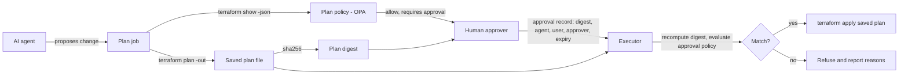

# Approval binding for agent-proposed infrastructure changes (v0.2)

**Status:** implemented for Terraform saved plans on GitHub Actions, as a demonstration and a reference pipeline. The path in which a second reviewer approves a run and the apply job proceeds has not yet been exercised end to end. Not production-ready.

## The problem

Teams that let an AI agent propose infrastructure changes usually keep a person in the loop: the agent opens a change, a person reviews and approves it, and a pipeline applies it. That review protects against a manipulated or mistaken agent only if the change that runs is the change the person saw.

In practice the two can drift apart:

1. **Re-planning after approval.** The pipeline runs `terraform plan` again at apply time. Anything that changed since the review (the code, a variable, the state of the world) changes what is applied.
2. **Substitution.** The approval is attached to a pull request or a pipeline run, not to an artifact. A different plan file can be applied under the same approval.
3. **Identity drift.** The approval was given for a change requested by one agent on behalf of one user, and a different agent or user executes it.
4. **Stale approvals.** An approval given last week is used today.

The agent is not trusted to prevent any of this. Its output can be steered by text it reads (issues, comments, documentation), so the check has to sit in the executor, not in the agent.

## What v0.2 guarantees

Within one GitHub Actions workflow that applies a Terraform saved plan, the executor applies a plan only if all of these hold:

- the plan passes the plan policy (no out-of-scope resource types, no changes to protected resources);
- if the plan policy marks the change high-risk, an approval record exists;
- the SHA-256 digest of the plan file the executor is about to apply equals the digest in the approval record;
- the agent and the user the agent acts for are the ones named in the approval record;
- the approver is neither the requesting user nor the agent;
- the approval has not expired.

Any failed check refuses the apply and reports the reasons.

## Flow

## What is bound

| Field | Source | Why |
| --- | --- | --- |
| `plan_sha256` | SHA-256 of the saved plan file | Ties the approval to one artifact |
| `agent` | Identity of the agent that proposed the change | Another agent cannot reuse the approval |
| `requested_by` | The user the agent acts for | Another user cannot reuse the approval |
| `approver` | The person who approved | Blocks self-approval |
| `expires_at` | Set when the approval is recorded | Blocks stale approvals |

The digest covers the saved plan file as bytes. The executor must hash the same file it passes to `terraform apply`.

## Limits

These are outside the v0.2 guarantee:

- **Other paths to the same infrastructure.** If the agent, or anyone, holds credentials that can change the infrastructure outside this workflow, this control does not see it. Closing that path needs identity and network controls (AAC-ID-01, AAC-GW-01).
- **Direct tool calls.** Changes made through an MCP server or CLI rather than the pipeline are a later stage.
- **Administrators.** A repository or cloud administrator can change the workflow or bypass it.
- **Correctness.** A matching digest shows the applied plan is the approved plan. It does not show the plan is safe or that the reviewer understood it.
- **Identity source.** In the demonstration script, the agent, user, and approver values are written by the script. In the reference pipeline they come from the verified GitHub Actions OIDC token and GitHub's review history (see [`examples/terraform_pipeline`](../examples/terraform_pipeline/README.md)). The pipeline's "agent" is the workflow that runs; it does not distinguish an AI agent from any other caller of that workflow.
- **Other CI systems and production use.**

## How it is demonstrated

A script run in CI against a small Terraform configuration that needs no cloud account:

1. Plan, record an approval for the plan's digest, apply: allowed.
2. Plan again with a different input after approval and try to apply under the same approval: refused, digest mismatch.
3. Same plan, different agent: refused.
4. Same plan, expired approval: refused.
5. Same plan, approver is the requester: refused.
6. Same plan, no approval: refused.

[`scripts/demo_baseline_no_binding.sh`](../scripts/demo_baseline_no_binding.sh) runs the case 2 swap with the control removed, to show what the control changes. What the baseline models, and what it does not, is in [evaluation.md](evaluation.md).
