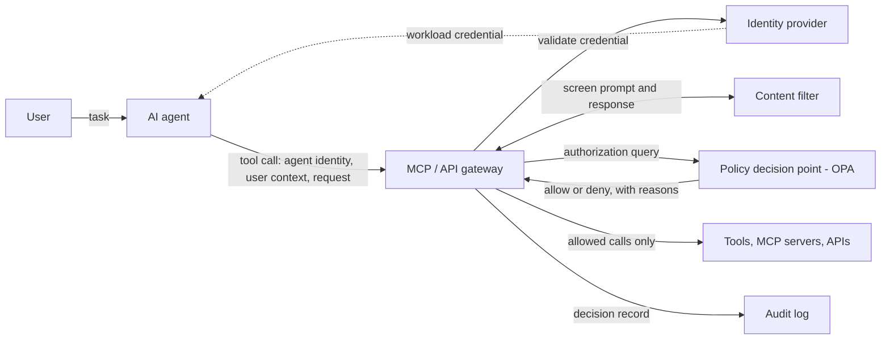

# Reference architecture

This project has three enforcement paths: the change path (Terraform plans applied by a pipeline), the image path (container images admitted to a cluster), and the tool-call path (tool and API calls through a gateway). The diagram and request flow below describe the tool-call path. The other two are summarized after it.

## Tool-call path

Agents never call tools or APIs directly. Every call passes through a gateway, which asks a policy decision point whether to allow it, screens content, enforces quotas, and records the outcome.



### Request flow

1. The agent authenticates with its own workload credential (AAC-ID-01) and sends the tool call, with the user it is acting for, to the gateway.
2. The gateway validates the credential and screens the content (AAC-CF-01).
3. The gateway sends an authorization query to the policy decision point. The policy in [`policies/tool_authz`](../policies/tool_authz/) checks:
   - the agent is granted this server, tool, and action (AAC-AZ-01);
   - the user holds the entitlement the tool requires (AAC-AZ-02);
   - a high-impact action carries a recorded approval (AAC-AZ-03).
4. The gateway forwards allowed calls and rejects the rest. It applies per-agent quotas (AAC-RL-01).
5. The gateway writes the decision record to the audit log (AAC-AU-01).
6. Network rules block any path from agents to backends that bypasses the gateway (AAC-GW-01).

### Trust boundaries

- **Agent runtime:** untrusted for authorization purposes. An agent's output can be manipulated through prompt injection, so its requests are checked rather than trusted.
- **Gateway and policy decision point:** the enforcement boundary. Policy and grants are managed as code and reviewed.
- **Backends:** trust only the gateway, not agents directly.

### Policy input

The gateway sends the policy decision point a document of this shape:

```json
{
  "agent":   { "id": "invoice-assistant", "identity_verified": true },
  "user":    { "id": "u-1001", "entitlements": ["finance:read"] },
  "request": { "server": "erp-mcp", "tool": "get_invoice", "action": "read",
               "approval": { "granted": false } }
}
```

Grants and tool metadata are supplied as policy data. See [`examples/tool_authz/data.json`](../examples/tool_authz/data.json).

### Decision record

For each query the policy returns a decision record, defined by [`schemas/decision-record.schema.json`](../schemas/decision-record.schema.json). The gateway writes it to the audit log (AAC-AU-01).

```json
{
  "schema_version": "0.2.0",
  "allow": false,
  "reasons": ["high-impact action requires approval"],
  "agent": "invoice-assistant",
  "user": "u-3003",
  "server": "erp-mcp",
  "tool": "issue_refund",
  "action": "write",
  "request_id": "req-7f3c",
  "impact": "high",
  "approval_granted": false,
  "approver": null
}
```

The record names the identities and the outcome. It leaves out the user's entitlements and the request payload, so the audit log does not become a second copy of sensitive data. Retention and tamper protection belong to the log pipeline and are not defined here yet.

### Deployment targets (planned)

- An open-source gateway on Kubernetes, with workload identity and network policies.
- A managed cloud API gateway, with the same policy and decision records.

## Change path

The tool-call path covers calls an agent makes through a gateway. Infrastructure changes an agent proposes through a pipeline are enforced at a different point, the executor that applies the change:

1. The pipeline saves the Terraform plan and records its SHA-256 digest. The plan policy ([`policies/terraform_plan`](../policies/terraform_plan/)) denies out-of-scope or protected changes and marks high-risk ones as needing approval (AAC-CH-01).
2. A person approves. The approval names the plan digest, the agent, the requesting user and an expiry, and must come from someone other than the requester or the agent (AAC-CH-02, AAC-CH-04).
3. Before applying, the executor recomputes the digest of the plan it holds and asks the approval policy ([`policies/change_approval`](../policies/change_approval/)) whether the approval covers it, for this agent and user, now. It applies only on an allow (AAC-CH-03).

The workload identity of the run comes from the GitHub Actions OIDC token ([`policies/workload_identity`](../policies/workload_identity/)). Design and limits: [approval-binding.md](approval-binding.md).

## Image path

1. An approval for an exact image digest is written as an in-toto Statement and signed. Before use, the signature and the record's consistency are verified; a record that fails is treated as no approval (AAC-AU-02, partial).
2. The image approval policy ([`policies/image_admission`](../policies/image_admission/)) allows a request only for that digest, agent and user, before expiry, with an independent approver. On an allow it publishes the digest to the `approved-images` ConfigMap (AAC-CH-05).
3. In namespaces managed by agents, a built-in Kubernetes `ValidatingAdmissionPolicy` refuses any pod whose images are not pinned to a published digest, whoever creates the pod (AAC-CH-06).

The cluster trusts the published list, not the agent and not stage 1. Who can edit that list, and who holds the signing key, are open. Design and limits: [image-admission.md](image-admission.md).
