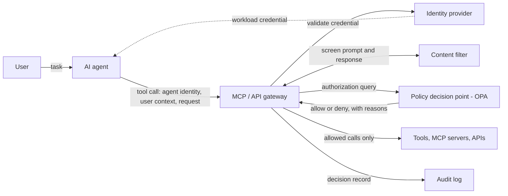

# Reference architecture

Agents never call tools or APIs directly. Every call passes through a gateway, which asks a policy decision point whether to allow it, screens content, enforces quotas, and records the outcome.



## Request flow

1. The agent authenticates with its own workload credential (AAC-ID-01) and sends the tool call, with the user it is acting for, to the gateway.
2. The gateway validates the credential and screens the content (AAC-CF-01).
3. The gateway sends an authorization query to the policy decision point. The policy in [`policies/tool_authz`](../policies/tool_authz/) checks:
   - the agent is granted this server, tool, and action (AAC-AZ-01);
   - the user holds the entitlement the tool requires (AAC-AZ-02);
   - a high-impact action carries a recorded approval (AAC-AZ-03).
4. The gateway forwards allowed calls and rejects the rest. It applies per-agent quotas (AAC-RL-01).
5. The gateway writes the decision record to the audit log (AAC-AU-01).
6. Network rules block any path from agents to backends that bypasses the gateway (AAC-GW-01).

## Trust boundaries

- **Agent runtime:** untrusted for authorization purposes. An agent's output can be manipulated through prompt injection, so its requests are checked rather than trusted.
- **Gateway and policy decision point:** the enforcement boundary. Policy and grants are managed as code and reviewed.
- **Backends:** trust only the gateway, not agents directly.

## Policy input

The gateway sends the policy decision point a document of this shape:

```json
{
  "agent":   { "id": "invoice-assistant", "identity_verified": true },
  "user":    { "id": "u-1001", "entitlements": ["finance:read"] },
  "request": { "server": "erp-mcp", "tool": "get_invoice", "action": "read",
               "approval": { "granted": false } }
}
```

Grants and tool metadata are supplied as policy data. See [`examples/tool_authz/data.json`](../examples/tool_authz/data.json).

## Deployment targets (planned)

- An open-source gateway on Kubernetes, with workload identity and network policies.
- A managed cloud API gateway, with the same policy and decision records.
